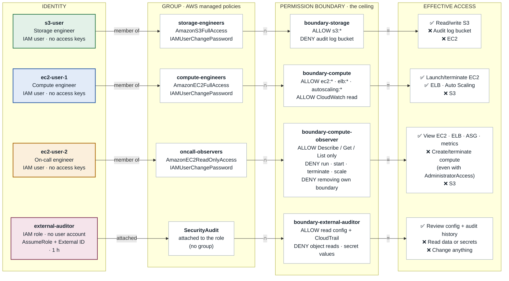

# Privileges Architecture: how access is shared between users, groups and boundaries

**Project:** Onward Logistics secure onboarding · **Account:** prod · **Region:** us-east-1
**Owner:** Patrick Ndaziramiye · **Source of truth:** [templates/onboarding.yaml](templates/onboarding.yaml)

Each engineer joins one group per job function. The group grants the day-to-day permissions through AWS managed policies. A permission boundary on every identity sets the ceiling, so access can never grow beyond the role, even if someone over-grants later. Outside parties never get a user account; they assume a short-lived role.

```
Effective access  =  Group policies  ∩  Permission boundary        (an explicit Deny always wins)
```

---

## 1. Access architecture

Read each lane left to right. In AWS, group and boundary names carry the `onward-prod-` prefix.



| Symbol | Meaning |
|---|---|
| **member of** | The user inherits the group's managed policies. |
| **∩** | Only actions allowed by *both* the policies and the boundary work. |
| **DENY** | An explicit deny in a boundary overrides any allow, from any policy, now or later. |

---

## 2. Access matrix

| Action | s3-user (storage) | ec2-user-1 (compute) | ec2-user-2 (on-call) | external-auditor (role) |
|---|---|---|---|---|
| Read and write S3 objects | ✅ Allowed | ⛔ Denied | ⛔ Denied | ❌ Explicit deny |
| Modify the audit log bucket | ❌ Explicit deny | ⛔ Denied | ⛔ Denied | ◐ Settings only |
| View EC2, load balancers, Auto Scaling | ⛔ Denied | ✅ Allowed | ✅ Allowed | ✅ Allowed |
| Launch, start or terminate instances | ⛔ Denied | ✅ Allowed | ❌ Explicit deny | ⛔ Denied |
| Create or resize Auto Scaling groups | ⛔ Denied | ✅ Allowed | ❌ Explicit deny | ⛔ Denied |
| Look up CloudTrail history | ⛔ Denied | ⛔ Denied | ⛔ Denied | ✅ Allowed |
| Read IAM configuration | ◐ Own user only | ◐ Own user only | ◐ Own user only | ✅ Allowed |
| Read secret values | ⛔ Denied | ⛔ Denied | ⛔ Denied | ❌ Explicit deny |
| Change own password | ✅ Allowed | ✅ Allowed | ✅ Allowed | n/a |
| Remove own permission boundary | ⛔ Denied | ⛔ Denied | ❌ Explicit deny | ⛔ Denied |

✅ Allowed · ⛔ Denied (not granted) · ❌ Explicit deny (cannot be overridden) · ◐ Partial

---

## 3. Proof: the ceiling holds under over-granting

On **19 October 2026**, [verify-access.sh](verify-access.sh) attached **AdministratorAccess** to both the `oncall-observers` group and `ec2-user-2` directly, then asked the IAM policy simulator what the on-call engineer could do. The script removed AdministratorAccess again afterwards.

| Action tested on ec2-user-2 | Simulator result |
|---|---|
| `ec2:RunInstances` | ❌ explicitDeny |
| `ec2:TerminateInstances` | ❌ explicitDeny |
| `ec2:StartInstances` | ❌ explicitDeny |
| `autoscaling:CreateAutoScalingGroup` | ❌ explicitDeny |
| `iam:DeleteUserPermissionsBoundary` | ❌ explicitDeny |
| `ec2:DescribeInstances` | ✅ allowed |

---

## 4. Controls shared by every identity

| Control | How it works |
|---|---|
| **Secure first login** | Secrets Manager generates a 20-character password per engineer (`onward/prod/onboarding/<user>`). A reset is forced at first sign-in, and no access keys exist. |
| **Every change is recorded** | The multi-Region trail `onward-prod-access-audit` logs every IAM change to an encrypted, versioned bucket. Storage engineers are explicitly denied that bucket. |
| **Defined once, in Git** | Users, groups, boundaries and the auditor role all come from `templates/onboarding.yaml`. No inline policies exist; changing access means a reviewed commit. |
