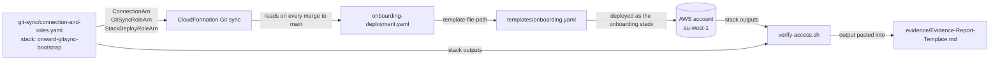
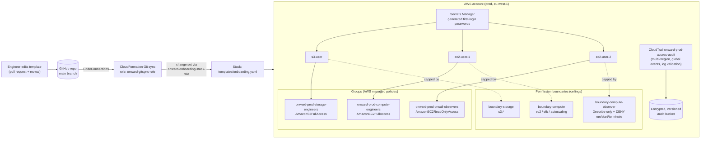

# Automating Secure Onboarding at Scale for Onward Logistics

**Module:** Security & Identity Management on AWS · Week 1
**Author / Owner:** Patrick Ndaziramiye
**Region:** eu-west-1
**Discovery report:** [Discovery-Report-Template.md](Discovery-Report-Template.md)

I built Onward Logistics' engineer onboarding as code. Every user, group, guardrail, first-login credential and the audit trail is defined in one CloudFormation template in this repository. A Git sync-enabled stack deploys it, so nothing is clicked together in the console. Every change to access is a Git commit with an author and a time, and CloudTrail also records the change inside AWS.

---

## How the project is arranged

```text
AWS_Module01_LAB/
├── git-sync/
│   └── connection-and-roles.yaml   1. Bootstrap (once): Git connection + the two deploy roles
├── onboarding-deployment.yaml      2. Git sync deployment file: points to the template below
├── templates/
│   └── onboarding.yaml             3. What gets onboarded: boundaries, groups, secrets, users, trail
├── verify-access.sh                4. Evidence script: checks the live account against 1 and 3
├── evidence/
│   ├── README.md                      How to save and fill in evidence
│   └── Evidence-Report-Template.md 5. Report for the Head of Security
├── Privillages-Architecture.md        How access is shared: users, groups, boundaries, matrix
├── Discovery-Report-Template.md       Stage 1 discovery report
└── AWS Lab01 Architecture.png         Architecture diagram
```

The numbers are the order things happen in:



**How the files connect**

| File | Provides | Used by |
|---|---|---|
| `git-sync/connection-and-roles.yaml` | Outputs `ConnectionArn`, `GitSyncRoleArn`, `StackDeployRoleArn` | Git sync stack set-up (step 3 below), `verify-access.sh` §8 |
| `onboarding-deployment.yaml` | Template path, parameters (`Environment`, `CreateAuditTrail`) and stack tags | CloudFormation Git sync |
| `templates/onboarding.yaml` | Outputs every user, group, boundary, secret ARN, trail and audit bucket name | `verify-access.sh` §1–§7 |
| `verify-access.sh` | Evidence that the deployed account matches both templates | `evidence/Evidence-Report-Template.md` |

Every file starts with a short header saying what it is, how it is deployed or run, and which other file uses it. Every resource in both templates has a one-line comment above it.

---

## How each requirement is met

| Client requirement | How I met it | Evidence (section in `verify-access.sh`) |
|---|---|---|
| Onboard `s3-user` (storage), `ec2-user-1` (compute) and `ec2-user-2` (on-call, observe only), each with only what the role needs | One IAM group per job function, built from AWS managed policies only. Each user also has a role-specific permission boundary. | §1: simulator shows in-role actions allowed and out-of-role actions denied |
| On-call engineer can **never** create or terminate compute, even if permissions are loosened later | `onward-prod-boundary-compute-observer` allows only read actions and explicitly denies run, start, terminate and Auto Scaling changes. It also denies removing the boundary. Effective access is policies ∩ boundary, so anything added later cannot exceed it. | §2: AdministratorAccess is attached to the group *and* the user, and the actions are still denied. §3: it is removed again |
| Repeatable and auditable: every change traced to a person and a time | (a) Git history shows who changed the definition and when. (b) A multi-Region CloudTrail trail with global service events and log file validation records who changed access in AWS. Logs go to an encrypted, versioned, non-public bucket that is retained on stack deletion. | §4, §5 |
| No inline policies; cap permissions in a forward-looking way | Only AWS managed policies on groups, customer managed **permission boundaries** as ceilings, and no `AWS::IAM::Policy` or inline `Policies`. The only policy document attached to a resource is the S3 bucket policy that CloudTrail requires, which is not an IAM inline policy. | §6: inline policy count is 0 for every user and group |
| Secure first login, no shared plain-text credential, forced change at first sign-in | Secrets Manager generates a 20-character password per user. CloudFormation reads it with a dynamic reference, so it never appears in Git. `PasswordResetRequired: true`. No access keys are created. | §7 |
| Everything provisioned with CloudFormation, deployed with Git sync | `templates/onboarding.yaml` + `onboarding-deployment.yaml` (Git sync deployment file). The bootstrap roles and connection are also CloudFormation. | §8 |
| Prove it to the Head of Security | `verify-access.sh` produces one evidence run | Whole script, with output saved in `evidence/` and summarised in `evidence/Evidence-Report-Template.md` |

---

## Architecture



**Effective access = group policies ∩ permission boundary.** The group gives the engineer their day-to-day job, and the boundary sets the upper limit nobody can raise without changing the reviewed template.

---

## Rebuild from the repository

Prerequisites: AWS CLI v2, Git Bash, admin credentials for the target account (outside this repo), and access to this GitHub repo.

1. **Bootstrap (once per account)** from `git-sync/connection-and-roles.yaml`. This creates the connection and the deploy roles.
   ```bash
   aws cloudformation deploy --region eu-west-1 \
     --template-file git-sync/connection-and-roles.yaml \
     --stack-name onward-gitsync-bootstrap --capabilities CAPABILITY_NAMED_IAM \
     --tags Project=secure-onboarding Owner=platform-security ManagedBy=cloudformation
   ```
2. **Approve the GitHub connection.** In *Developer Tools → Settings → Connections*, finish the handshake for `onward-onboarding-repo`. AWS requires a person to do this step.
3. **Create the Git sync stack** in eu-west-1. In CloudFormation, choose *Create stack → Sync from Git*, select this repo, the `main` branch and the deployment file `onboarding-deployment.yaml`. Use `GitSyncRoleArn` (`onward-gitsync-role`) as the Git sync role and `StackDeployRoleArn` (`onward-onboarding-stack-role`) as the stack's service role.
4. **Hand over first logins.** An admin reads each password once from Secrets Manager (`onward/prod/onboarding/<user>`) and gives it to the new hire over a separate channel. The hire must change it at first sign-in.
5. **Collect evidence** with `verify-access.sh`.
   ```bash
   mkdir -p evidence && ./verify-access.sh | tee evidence/verify-access-$(date +%Y%m%d).txt
   ```
   The script takes every name from the stack outputs, so it always checks what Git defines. Fill in `evidence/Evidence-Report-Template.md` from the output.

From then on, onboarding a new engineer or changing access means editing `templates/onboarding.yaml` and merging to `main`. Git sync applies the change.

**Clean-up:** delete the Git sync stack, then the `onward-gitsync-bootstrap` stack. The audit bucket is retained on purpose (audit evidence). Empty and delete it manually only when the retention requirement no longer applies.

---

## Region

**Choice: `eu-west-1` (Ireland).** Both stacks, the trail's home Region, the audit bucket and the first-login secrets live there. CloudFormation Git sync and every service used here are available in eu-west-1, and it is a mature, lower-cost Region with good latency to West Africa. Every command in `verify-access.sh` runs against eu-west-1. IAM is a global service; the multi-Region trail includes global service events, so IAM changes are written to the audit bucket in eu-west-1. This lab stores no customer or merchant data, so data-residency rules for West African markets are not affected. When later labs host customer data, I will choose the Region by latency and data-protection law. `af-south-1` (Cape Town) is the likely candidate.

---

## Decisions log

| # | Decision | Reason (business terms) |
|---|---|---|
| 1 | Onboarding as CloudFormation in Git, deployed by Git sync | The same result every time, whoever is on shift. Every change is reviewed, has an author and a timestamp, and can be rolled back. |
| 2 | Groups per job function, AWS managed policies only | Access is decided once per role, not per person. AWS maintains the policies, so the small platform team has less to look after. |
| 3 | Permission boundaries on every engineer | A hard ceiling that still holds if someone later over-grants by mistake. This directly answers the "not even if someone loosens permissions" requirement. |
| 4 | Explicit deny for compute changes in the on-call boundary | Documents the intent and survives future edits to the allow-list. On-call staff cannot cause an outage on a peak day. |
| 5 | On-call engineer gets no S3 access | Their job is only to confirm deployments landed. Reading storage could expose customer data, and protecting data is a top-two priority. |
| 6 | Secrets Manager-generated passwords with forced reset | No password is ever typed, chatted or committed. The admin never knows the engineer's working password. |
| 7 | No access keys for engineers | Avoids long-lived credentials, as the company access standard requires. |
| 8 | Multi-Region trail, log file validation, retained encrypted bucket | Auditors can trust the logs are complete and unaltered, and the evidence outlives the stack. |
| 9 | Separate deploy roles for Git sync and the stack | People do not need standing rights to change IAM. Only the reviewed pipeline makes changes. |

---

## Standards compliance

- **Naming:** `onward-<env>-<purpose>` for groups, boundaries and the trail; `onward-gitsync-*` / `onward-onboarding-*` for the bootstrap. User names follow the lab brief (`s3-user`, `ec2-user-1`, `ec2-user-2`).
- **Tags:** the stack tags in `onboarding-deployment.yaml` (`Project=secure-onboarding`, `Owner=platform-security`, `ManagedBy=cloudformation-gitsync`) propagate to every resource that supports tags.
- **Access:** least privilege per role, no shared accounts, no access keys.
- **Automation:** 100% CloudFormation from Git. The only manual step is the GitHub handshake, which AWS requires.

## Known limits / next steps

- Deny the audit log bucket in the storage boundary, so storage engineers cannot edit or delete audit evidence.
- Give outside parties temporary, read-only access through a role with an External ID, never an IAM user.
- Add a monthly AWS Budget with email alerts so spend is visible from day one (the bootstrap deploy role would then also need `budgets:*`).
- Enforce MFA for console users, through a boundary condition on `aws:MultiFactorAuthPresent` plus MFA self-service permissions.
- Move engineers to IAM Identity Center with short-lived credentials once the company has an identity provider.
- Scope the storage and compute boundaries to tagged or named resources, and narrow the stack deploy role (currently `iam:*`).
- Protect `main` with required reviews so that "who approved this" is a named reviewer on every change.
