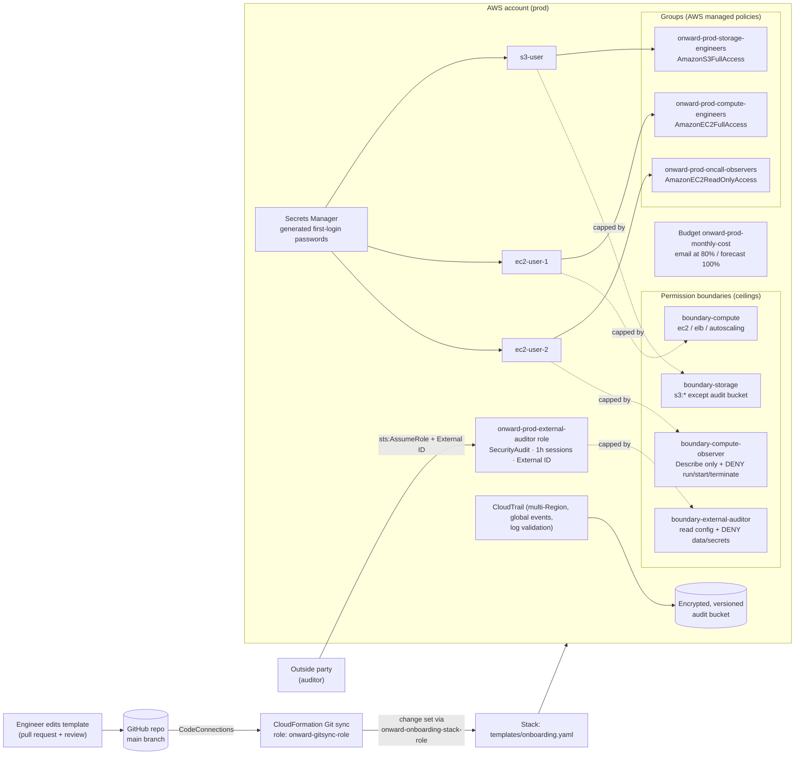

# Automating Secure Onboarding at Scale for Onward Logistics

**Module:** Security & Identity Management on AWS · Week 1
**Author / Owner:** Patrick Ndaziramiye
**Discovery report:** [Discovery-Report-Template.md](Discovery-Report-Template.md)

I built Onward Logistics' engineer onboarding as code. Every user, group, guardrail, credential, audit trail and budget is defined in one CloudFormation template in this repository. A Git sync-enabled stack deploys it, so nothing is clicked together in the console. Every change to access is a Git commit with an author and a time, and CloudTrail also records the change inside AWS.

---

## How each requirement is met

| Client requirement | How I met it | Evidence (section in `verify-access.sh`) |
|---|---|---|
| Onboard `s3-user` (storage), `ec2-user-1` (compute) and `ec2-user-2` (on-call, observe only), each with only what the role needs | One IAM group per job function, built from AWS managed policies only. Each user also has a role-specific permission boundary. | §1: simulator shows in-role actions allowed and out-of-role actions denied |
| Secure first login, no shared plain-text credential, forced change at first sign-in | Secrets Manager generates a 20-character password per user. CloudFormation reads it with a dynamic reference, so it never appears in Git. `PasswordResetRequired: true`. No access keys are created. | §7 |
| On-call engineer can **never** create or terminate compute, even if permissions are loosened later | `onward-prod-boundary-compute-observer` allows only read actions and explicitly denies run, start, terminate and Auto Scaling changes. It also denies removing the boundary. Effective access is policies ∩ boundary, so anything added later cannot exceed it. | §2: AdministratorAccess is attached to the group *and* the user, and the actions are still denied |
| Repeatable and auditable: every change traced to a person and a time | (a) Git history shows who changed the definition and when. (b) A multi-Region CloudTrail trail with global service events and log file validation records who changed access in AWS. Logs go to an encrypted, versioned, non-public bucket that is retained on stack deletion and that storage engineers are explicitly denied. | §4, §5 |
| Prove it to the Head of Security | `verify-access.sh` produces a single evidence report | Whole script, with output saved in `evidence/` |
| *Week 1:* people outside the company get only temporary, limited access | No IAM users for outsiders. `onward-prod-external-auditor` is a role with a 1-hour maximum session and an External ID condition, using the AWS managed `SecurityAudit` policy and capped by a read-only boundary that denies data and secret reads. | §8 |
| *Week 1:* spend is visible from day one | `onward-prod-monthly-cost` budget emails the owner at 80% of actual spend and 100% of forecast spend | §9 |
| Everything provisioned with CloudFormation, deployed with Git sync | `templates/onboarding.yaml` + `onboarding-deployment.yaml` (Git sync deployment file). The bootstrap roles and connection are also CloudFormation. | §10 |
| No inline policies; cap permissions in a forward-looking way | Only AWS managed policies on groups, customer managed **permission boundaries** as ceilings, and no `AWS::IAM::Policy` or inline `Policies`. The only policy document attached to a resource is the S3 bucket policy that CloudTrail requires, which is not an IAM inline policy. | §6: inline policy count is 0 for every user and group |

---

## Architecture



**Effective access = group policies ∩ permission boundary.** The group gives the engineer their day-to-day job, and the boundary sets the upper limit nobody can raise without changing the reviewed template.

---

## Repository layout

| Path | Purpose |
|---|---|
| `templates/onboarding.yaml` | Everything that gets onboarded: boundaries, groups, secrets, users, audit trail, external role, budget |
| `onboarding-deployment.yaml` | Git sync deployment file: which template, parameters and stack tags |
| `git-sync/connection-and-roles.yaml` | One-time bootstrap: Git connection, the role Git sync uses, the service role the stack deploys with |
| `verify-access.sh` | Evidence script for the Head of Security |
| `evidence/` | Saved output of `verify-access.sh` |
| `Discovery-Report-Template.md` | Stage 1 discovery report |

---

## Rebuild from the repository

Prerequisites: AWS CLI v2, admin credentials for the target account (outside this repo), and access to this GitHub repo.

1. **Bootstrap (once per account).** This creates the connection and the deploy roles.
   ```bash
   aws cloudformation deploy --region us-east-1 \
     --template-file git-sync/connection-and-roles.yaml \
     --stack-name onward-gitsync-bootstrap --capabilities CAPABILITY_NAMED_IAM \
     --tags Project=onward "Owner=Patrick Ndaziramiye" Environment=prod
   ```
2. **Approve the GitHub connection.** In *Developer Tools → Settings → Connections*, finish the handshake for `onward-onboarding-repo`. AWS requires a person to do this step.
3. **Create the Git sync stack.** In CloudFormation, choose *Create stack → Sync from Git*, select this repo, the `main` branch and the deployment file `onboarding-deployment.yaml`. Use the role `onward-gitsync-role` for Git sync and `onward-onboarding-stack-role` as the stack's service role.
4. **Confirm the budget email.** Accept the AWS Budgets subscription email.
5. **Hand over first logins.** An admin reads each password once from Secrets Manager (`onward/prod/onboarding/<user>`) and gives it to the new hire over a separate channel. The hire must change it at first sign-in.
6. **Collect evidence.**
   ```bash
   mkdir -p evidence && ./verify-access.sh | tee evidence/verify-access-$(date +%Y%m%d).txt
   ```

From then on, onboarding a new engineer or changing access means editing the template and merging to `main`. Git sync applies the change.

**Clean-up:** delete the Git sync stack, then the bootstrap stack. The audit bucket is retained on purpose (audit evidence). Empty and delete it manually only when the retention requirement no longer applies.

---

## Region

**Choice: `us-east-1` (N. Virginia).** IAM is a global service, and its API events are delivered in us-east-1, so keeping the stack, the trail's home Region and the evidence queries there keeps audit lookups in one place. CloudFormation Git sync and every service used here are available there, and it is among the lowest-cost Regions. This lab stores no customer or merchant data, so data-residency rules for West African markets are not affected. When later labs host customer data, I will choose the Region by latency and data-protection law. `af-south-1` (Cape Town) is the likely candidate.

---

## Decisions log

| # | Decision | Reason (business terms) |
|---|---|---|
| 1 | Onboarding as CloudFormation in Git, deployed by Git sync | The same result every time, whoever is on shift. Every change is reviewed, has an author and a timestamp, and can be rolled back. |
| 2 | Groups per job function, AWS managed policies only | Access is decided once per role, not per person. AWS maintains the policies, so the small platform team has less to look after. |
| 3 | Permission boundaries on every identity | A hard ceiling that still holds if someone later over-grants by mistake. This directly answers the "not even if someone loosens permissions" requirement. |
| 4 | Explicit deny for compute changes in the on-call boundary | Documents the intent and survives future edits to the allow-list. On-call staff cannot cause an outage on a peak day. |
| 5 | On-call engineer gets no S3 access | Their job is only to confirm deployments landed. Reading storage could expose customer data, and protecting data is a top-two priority. |
| 6 | Storage boundary denies the audit bucket | The people with the widest S3 rights must not be able to edit or delete the evidence auditors rely on. |
| 7 | Secrets Manager-generated passwords with forced reset | No password is ever typed, chatted or committed. The admin never knows the engineer's working password. |
| 8 | No access keys for engineers | Avoids long-lived credentials, as the company access standard requires. |
| 9 | Outside parties use a role with 1-hour sessions and an External ID | Access is temporary by design and expires on its own. Nothing is left behind to forget to revoke, and the External ID prevents confused-deputy misuse. |
| 10 | Multi-Region trail, log file validation, retained encrypted bucket | Auditors can trust the logs are complete and unaltered, and the evidence outlives the stack. |
| 11 | Monthly budget with actual and forecast alerts | Spend is visible from day one, and the owner is warned before the money is gone. |
| 12 | Separate deploy roles for Git sync and the stack | People do not need standing rights to change IAM. Only the reviewed pipeline makes changes. |

---

## Standards compliance

- **Naming:** `onward-<env>-<purpose>` for groups, boundaries, the role, the trail and the budget. User names follow the lab brief (`s3-user`, `ec2-user-1`, `ec2-user-2`).
- **Tags:** the stack tags `Project=onward`, `Owner=Patrick Ndaziramiye`, `Environment=prod` propagate to every resource that supports tags.
- **Access:** least privilege per role, no shared accounts, no access keys, temporary credentials for outsiders.
- **Automation:** 100% CloudFormation from Git. The only manual steps are the GitHub handshake and confirming the budget email, both required by AWS.
- **Cost:** budget alerts are active, every resource has an owner tag, and the clean-up steps are documented above.

## Known limits / next steps

- Enforce MFA for console users, through a boundary condition on `aws:MultiFactorAuthPresent` plus MFA self-service permissions.
- Move engineers to IAM Identity Center with short-lived credentials once the company has an identity provider.
- Scope the storage and compute boundaries to tagged or named resources, and narrow the stack deploy role (currently `iam:*`).
- Protect `main` with required reviews so that "who approved this" is a named reviewer on every change.
- Alert on IAM changes in real time (EventBridge → SNS), and automate offboarding.
